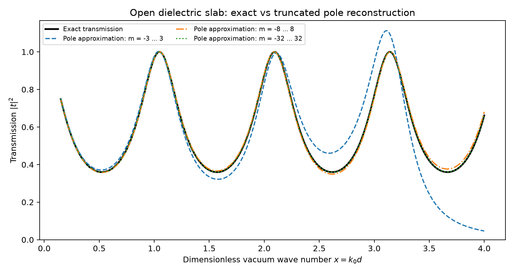
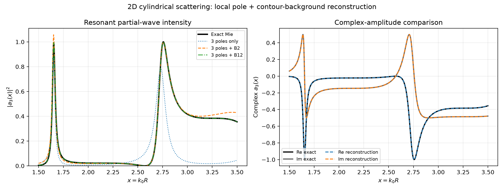
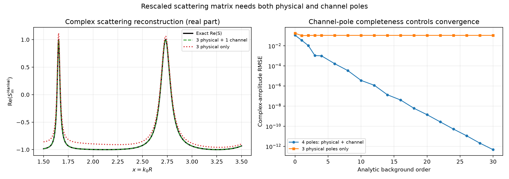
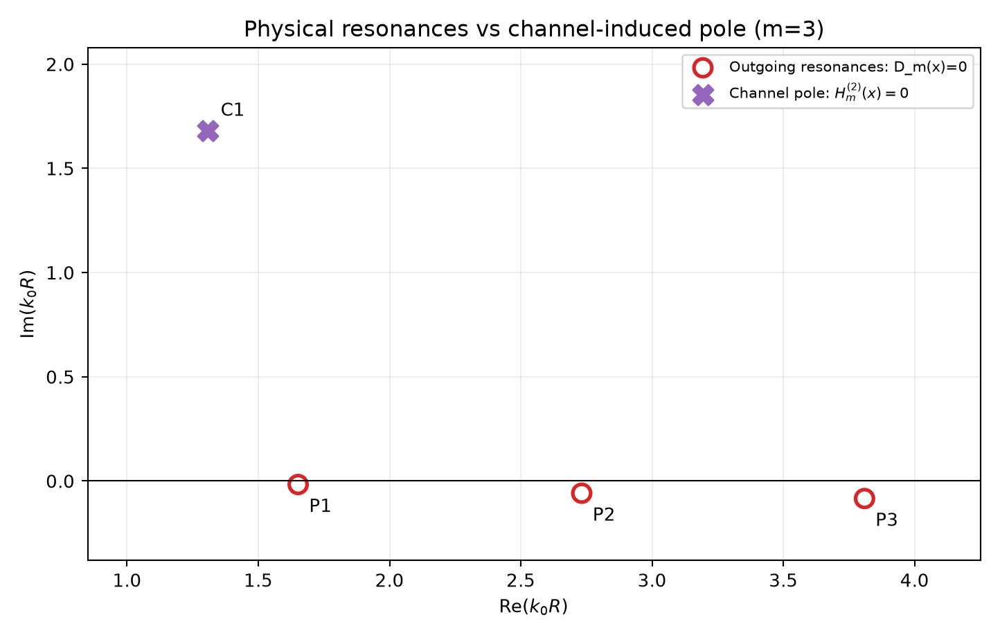

# Open Optical Resonators: 1D and 2D Scattering Pole Expansions

A small, fully reproducible **numerical benchmark** for complex-frequency optical resonances and scattering-amplitude reconstruction in a lossless one-dimensional dielectric slab **and a two-dimensional circular dielectric cylinder**. Intended as a learning and portfolio project in computational nanophotonics, especially the connection between **resonant poles**, **scattering matrices**, and **numerical convergence**.

The benchmarks combine an analytic 1D slab pole expansion, exact cylindrical
Mie scattering, local Cauchy pole–residue reconstruction, and three choices of
incoming/outgoing scattering-channel normalization. The analytic backgrounds
are computed from the exact scattering functions on complex integration contours.


## Selected figures

### Slab scattering and pole-sum reconstruction

Exact slab transmission compared with truncated resonance-pole expansions.

### Cylinder reconstruction and analytic background

The pole contribution and local analytic background are compared with the exact cylindrical scattering amplitude.

### Completeness under channel rescaling

Reconstruction with and without the additional normalization-induced channel pole. The background is evaluated from the exact response on a complex contour.

### Physical and channel poles

Outgoing dielectric resonances are distinguished from poles introduced by the Hankel channel convention.

## Core physics

For a homogeneous lossless dielectric slab with refractive index \(n>1\), thickness \(d\), ambient refractive index 1, and normal-incidence plane-wave illumination, define \(x=k_0d\) with the time convention \(e^{-i\omega t}\). The two-port scattering matrix (referenced to the slab interfaces) is

\[
S(x)=\begin{pmatrix}r(x)&t(x)\\t(x)&r(x)\end{pmatrix},
\quad D(x)=\cos(nx)-i\frac{n^2+1}{2n}\sin(nx),
\]

\[
t(x)=\frac{1}{D(x)},\qquad
r(x)=\frac{i(n^2-1)\sin(nx)}{2nD(x)}.
\]

For the outgoing (quasinormal-mode) condition, \(D(x_m)=0\), the complex poles are

\[
x_m = \frac{m\pi - i\log[(n+1)/(n-1)]}{n},\quad m\in\mathbb{Z}.
\]

These are poles in the **lower** half of the complex frequency plane (for the stated time convention). Their residues are analytically known:

\[
\mathrm{Res}[t]_{x_m}=\frac{i(-1)^m}{nB},\qquad
\mathrm{Res}[r]_{x_m}=\frac{i}{nB},\qquad B=\frac{n^2-1}{2n}.
\]

We use a **zero-frequency anchored, symmetric truncation** of the pole sum to reconstruct each complex scattering amplitude:

\[
f_N(x) = f(0) + \sum_{m=-N}^{N} \mathrm{Res}[f]_{x_m}
\left[\frac{1}{x-x_m} - \frac{1}{-x_m}\right],
\]

with \(t(0)=1\) and \(r(0)=0\). We benchmark the truncation error versus \(2N+1\), compare amplitude rather than just intensity, and test optical energy conservation of the exact solution. The finite sum need not conserve energy exactly.

A separate exercise perturbs the material index \(n\rightarrow n+\Delta n\) and compares exact complex-pole shifts with a first-order derivative formula; both the resonance frequency and radiative linewidth respond.

## Reproduce

Python 3.10+ with NumPy, SciPy and Matplotlib installed.

```bash
python -m pip install -r requirements.txt
python run_demo.py
python run_cylinder.py
python run_cylinder_pole_expansion.py
python run_channel_rescaling.py
python -m unittest discover -s tests -v
```

Outputs are written into `outputs/` (thirteen PNG figures and five CSV files). The provided figures are generated by the code, not by an electromagnetic field solver or experiment.

## Results and interpretation

- `01_transmission_comparison.png`: exact versus finite pole sums.
- `02_convergence.png`: complex-amplitude RMS error as the number of retained poles increases.
- `03_complex_poles.png`: locations of outgoing poles in the lower complex plane.
- `04_pole_sensitivity.png`: complex-frequency shifts from a small refractive-index perturbation, exact versus first order.
- `05_cylinder_scattering.png`: 2D TM_z cylinder Mie-type scattering efficiency and angular-channel contributions.
- `06_cylinder_complex_poles.png`: selected complex outgoing poles from Bessel/Hankel boundary conditions (local numerical root search).
- `07_cylinder_pole_reconstruction.png`: exact 2D Mie amplitude versus three poles alone and poles plus analytic background.
- `08_cylinder_pole_convergence.png`: truncation in pole number and background polynomial order.
- `09_cylinder_two_channel_validation.png`: second-channel cross-check (angular orders m=2,3).
- `convergence_metrics.csv`: reproducible 1D numerical error metrics.
- `cylinder_pole_expansion_metrics.csv`: 2D complex-amplitude RMSE and maximum error for different truncations.
- `cylinder_resonances_and_residues.csv`: verified outgoing poles, quality factors, and complex residues.

The transmission and reflection amplitudes can converge at different rates with the chosen anchored truncation; this is a *methodological* result of the benchmark, not evidence of new physics.

## 2D cylinder extension (implemented)

The 2D extension solves TM_z scattering for an infinite circular, isotropic, nonmagnetic cylinder using exact Bessel/Hankel boundary matching. This is an independent, circular-geometry verification problem; it does **not** assume a finite-height metasurface pillar.

The outgoing resonances are roots of

\[
D_m(x)=J_m(nx)H_m^{(1)\prime}(x)-nJ_m^{\prime}(nx)H_m^{(1)}(x)=0,
\quad x=k_0R.
\]

Partial-wave S-matrix unitarity, \( |1+2a_m|=1 \), provides a strong numerical check of the exact lossless-cylinder implementation. `run_cylinder.py` illustrates scattering spectra and uses local complex root searches for representative poles.

**Implemented in v2:** a *local 2D cylinder pole–residue reconstruction* is benchmarked against exact Mie scattering, using an analytically justified Cauchy-background polynomial. **Stage 3 (implemented):** an independent cylindrical adaptation of scattering-channel rescaling, with physical versus channel-induced pole classification and a local residue-expansion completeness test.


## Local 2D pole–residue expansion: method (v2)

For each azimuthal angular order `m`, the exact cylinder coefficient is

\[
 a_m(z)=\frac{N_m(z)}{D_m(z)},\qquad
 D_m(z)=J_m(nz)H_m^{(1)\prime}(z)-nJ_m^{\prime}(nz)H_m^{(1)}(z),
\]

with dimensionless complex vacuum wavenumber \(z=k_0R\), cylinder index \(n=3\),
and outgoing Hankel waves \(H_m^{(1)}\). The numerator is in `cylinder_mie.py`.
The poles are the zeros of `D_m` in the lower half-plane (time convention
\(e^{-i\omega t}\)). For simple poles \(p_j\),

\[
 r_j=\operatorname{Res}_{z=p_j} a_m(z)=\frac{N_m(p_j)}{D_m'(p_j)}.
\]

**Why a background is necessary:** The exact 2D Mie coefficient involves cylindrical
Hankel functions with a branch point at the origin. A naive, finite sum of poles
is not a globally valid reconstruction. We work instead on a **local disk**
\(|z-c|<\rho\), with `c=2.6`, `rho=1.65`, entirely in the right half-plane and
away from the Hankel branch cut. On that domain, the following Cauchy identity is exact:

\[
 a_m(z)=\sum_{p_j\in C}\frac{r_j}{z-p_j} + B_m(z),\qquad
 B_m(z)=\frac{1}{2\pi i}\oint_C\frac{a_m(\zeta)}{\zeta-z}\,d\zeta.
\]

The analytic background is expanded around `c`:

\[
 B_m(z)=\sum_{k\ge 0} b_k(z-c)^k,\qquad
 b_k=\frac{1}{2\pi i}\oint_C\frac{a_m(\zeta)}{(\zeta-c)^{k+1}}\,d\zeta.
\]

A periodic trapezoidal quadrature with 4096 points evaluates these coefficients
from the **exact Mie response at complex contour points**. Pole counts are
certified independently by the argument-principle winding number of `D_m` on
that contour, preventing the selected local root searches from silently missing
an enclosed pole. The selected channels `m=2` and `m=3` each have three
outgoing poles inside the disk.

We benchmark the complex amplitude on the real interval `1.50 <= x <= 3.50`.
For `m=3`, including all three poles and a 20th-order background gives
complex-amplitude RMSE `3.66e-10` (701 evaluation points). The same three poles
**without any background** give RMSE about `3.65e-1`.
Missing one of the three poles leaves an error plateau even if the analytic
background order increases. This directly illustrates the importance of a
complete set of enclosed poles and an adequately represented nonresonant term.

**Numerical interpretation:** The very small reconstruction error is an
internal consistency result of a Cauchy identity that uses the exact Mie
solution on a contour. It must **not** be presented as a 1e-10-accurate
independent RSE prediction, a reproduction of Weiss et al.'s 2026 work, or
an experimental result. The model is an infinite *2D dielectric cylinder*,
not a finite-height 3D metasurface nanopillar. The separate Stage 3 module investigates channel rescaling and the resulting channel poles.

### Files added in v2

- `cylinder_pole_expansion.py`: residue formula, contour zero count,
  Cauchy background coefficients and truncated reconstruction.
- `run_cylinder_pole_expansion.py`: 2D benchmark, figures 07–09, tabulated errors.

On a successful full run the test suite reports `Ran 21 tests` and `OK`.

## Stage 3: scattering-channel rescaling and channel poles

The `channel_rescaling.py` and `run_channel_rescaling.py` modules implement
scattering-channel normalization for the **same 2D cylindrical partial-wave
system** used in Stage 2. For `E_z` polarization with
`x=k_0 R`, the standard scattering matrix is `S_m(x)=1+2*a_m(x)`.
Three analytic channel conventions are compared:

\[
S_m^{\mathrm{standard}}(x)=S_m(x),\qquad
S_m^{\mathrm{exponential}}(x)=e^{2ix}S_m(x),\qquad
S_m^{\mathrm{Hankel}}(x)=\frac{H_m^{(1)}(x)}{H_m^{(2)}(x)}S_m(x).
\]

For a rescaled incoming basis function `gamma_in H_m^(2)` and outgoing
basis `gamma_out H_m^(1)`, `S_new=(gamma_in/gamma_out)S_original`.
The physical field is exactly unchanged upon the corresponding inverse
rescaling of incoming and outgoing channel amplitudes. Exponential
normalization does not add poles. Hankel normalization also has **channel
poles**, zeros of `H_m^(2)`, which are distinct from the outgoing resonance
condition `D_m(x)=0` of the cylinder.

For the demonstrator `m=3, n=3`, a right-half-plane Cauchy contour contains
three outgoing resonances and one channel pole. Argument-principle
winding counts independently verify `3+1` enclosed roots. Residues at the
physical poles and at the new channel pole are obtained analytically.
With the contour-derived analytic background of order `B22`, restoring all
four poles yields a complex-amplitude RMSE of approximately `2.69e-10`
on real `1.5 <= k_0 R <= 3.5`; omitting the channel pole gives about `0.109`.

This is a **cylindrical benchmark extending the project's earlier Mie
calculations**, informed by the normalization mechanism in the cited 2026
Optics Letters paper, which studies spherical particles. The background
coefficients use the exact cylinder solution on the integration contour.

### Stage 3 outputs

- `10_channel_rescaling_complex_plane.png` — analytic continuation of S under three channel definitions; physical and channel-pole locations.
- `11_channel_rescaling_real_axis.png` — phase in different channel conventions and recovery of the same physical S.
- `12_channel_pole_completeness.png` — real-frequency response and complex-amplitude convergence with and without the channel pole.
- `13_physical_vs_channel_poles.png` — classifying outgoing resonances versus Hankel channel zeros.
- `channel_rescaling_convergence.csv` — error versus polynomial order, both pole sets.
- `channel_rescaling_poles.csv` — poles and residues in each scattering-channel convention.

Run:

```powershell
python run_channel_rescaling.py
python -m unittest discover -s tests -v
```

## Background references

1. Doost, Langbein, Muljarov, *Resonant-state expansion applied to planar open optical systems*, Physical Review A **85**, 023835 (2012), https://doi.org/10.1103/PhysRevA.85.023835
2. Fösleitner, Canós Valero, Sztranyovszky, Muljarov, Koshelev, Weiss, *Mittag-Leffler expansion of the optical scattering matrix via rescaled scattering channels*, Optics Letters **51**, 2656–2659 (2026), https://doi.org/10.1364/OL.585803
3. Austrian Science Fund, Thomas Weiss, *How accurate is the pole expansion of the scattering matrix?* (2023–2027), https://www.fwf.ac.at/en/research-radar/10.55776/P36864

This independent teaching/portfolio benchmark is not affiliated with the cited researchers or funded project.
